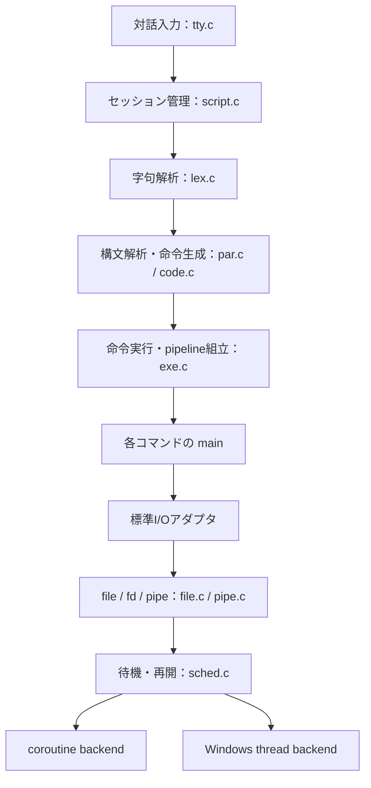
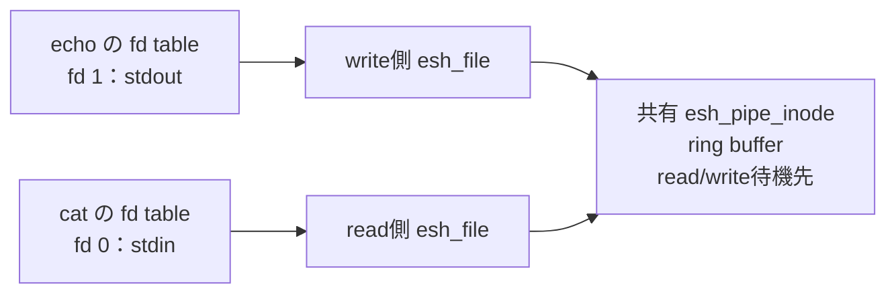

# パイプのしくみとソフトウェア構造：チャット記録

記録日: 2026-10-04
対象: 直前のユーザー質問、進捗メッセージ、最終回答
内部のツール実行ログは含めない。以下の発言本文は変更せず記録する。

## ユーザー

実装いただいたパイプのしくみとソフトウェアの構造を詳細に解説いただけますか

## アシスタント（進捗メッセージ 1）

実装コードを確認し、データの流れ、各モジュールの役割、待機・再開、資源回収まで順に解説します。設計資料と現在のコードに違いがある場合は、区別して説明します。

## アシスタント（進捗メッセージ 2）

別タスクでリファクタリングが進んでおり、現在の HEAD は Milestone 9 のコミットより先になっています。今回は現在のコードを基準に説明します。重要な点は、パイプ本体は OS の pipe を呼ばずに実装しており、coroutine と Windows thread が同じ I/O・待機契約を共有していることです。

## アシスタント（進捗メッセージ 3）

モジュール間の関係と待機・再開の流れが分かりやすくなるよう、visualize スキルを使って構造図を添えます。特に、「コマンドの実行状態を切り替える処理」と「データを蓄えるパイプ本体」を分けて説明します。

## アシスタント（最終回答）

今回の実装を一言でいうと、**「メモリ上のパイプ」と「コマンドを交代で動かす実行機構」を組み合わせた、小さな実行環境**です。

Windows の OS pipe を呼び出しているわけではありません。パイプ本体は移植可能な C コードで実装し、実行状態の切替だけを coroutine または Windows thread に任せています。

以下は、現在の `0b4790b` までのコードを確認した説明です。別タスクで行われたリファクタリングも反映しています。今回はコード変更や試験の再実行はしていません。

## 1. 全体の構造

たとえば、次の入力を考えます。

```sh
echo hello | cat | cat
```

入力の解析と、実際のデータ転送は別の処理です。



大きく分けると、次の四つの責務があります。

| 部分 | 役割 |
|---|---|
| shell | 入力を解析し、どのコマンドを接続するか決める |
| file・pipe | データを保持し、読み書き・EOF・broken pipe を判断する |
| scheduler | 実行可能なコマンドと、待機中のコマンドを管理する |
| backend | 実際に stack/context を切り替える、または thread を待機・再開させる |

この分離によって、coroutine から thread に切り替えても、pipe の読み書き処理を変更する必要がありません。

## 2. 入力が pipeline になるまで

### 2.1 `tty.c`：一行の入力を受け取る

`tty.c` はキー入力、行編集、履歴などを扱います。

Windows で `ESH_SCRIPT` が有効な場合、完成した行を `esh_script_line()` に渡します。ここで初めて、従来の「コマンドを直接呼ぶ処理」から、lexer・parser・executor を使う経路に入ります。

### 2.2 `script.c`：解析と実行の区切りを管理する

[script.c](C:/usr/src/MCUFW/src/core/esh/script.c) は、対話セッション用の `struct code` と `struct exe` を保持します。

通常の一行のコマンドは、解析完了後に実行します。一方、次のような入力は、`done` までコードを蓄積します。

```sh
while [ $k -le 3 ]
do
    echo $k
    k=`expr $k + 1`
done
```

つまり、ブロックの途中でコマンドを逐次実行するのではなく、**最外側の構文が完成してから executor に渡す**方式です。

実行終了後は命令・実行状態を初期化し、変数テーブルだけを保持します。現在のコードでは、この処理が `script_reset_preserving_variables()` に集約されています。

なお、`break` が parser のループ情報を参照するため、parser の初期化は実行後に行います。

### 2.3 `lex.c` と `par.c`：接続関係を命令にする

lexer は `|` を `T_PIPE` として認識します。ただし、引用符内の `|` は、tokenizer 側で区別されます。

parser は pipeline を、概念的には次の命令列に変換します。

```text
コマンド echo を登録
引数 hello を追加
OP_PIPE_NEXT
コマンド cat を登録
OP_PIPE_NEXT
コマンド cat を登録
OP_CMD_EXE
```

ここで重要なのは、`OP_PIPE_NEXT` 自体はまだデータを転送しないことです。

これは「このコマンド群を pipeline としてまとめて実行する」という接続情報です。executor が複数の `struct proc` を組み立て、最後の実行命令で pipeline を起動します。

パイプなしの単一コマンドは、基本的に applet の `main()` を直接呼びます。すべてのコマンドを常時 coroutine 化しているわけではありません。

## 3. 「process」は OS process ではない

ここでいう process は、Windows の独立したプロセスではありません。**一つのコマンドの実行状態を表す内部オブジェクト**です。

[exe.h](C:/usr/src/MCUFW/src/core/esh/include/exe.h) では、二つの構造体を組み合わせています。

### `struct proc`：shell 固有の情報

主に、次の情報を持ちます。

- 実行する applet
- `argc` と `argv`
- 引用変数を展開した引数用 buffer
- 埋め込まれた `struct esh_proc`

### `struct esh_proc`：実行環境の情報

主に、次の情報を持ちます。

- 実行状態
- process ごとの fd table
- 待機中の wait channel
- 待機リスト内の次の process
- backend の実行コンテキストへの参照
- command の終了 status

この分離により、scheduler は「echo の引数が何か」を知る必要がありません。scheduler が扱うのは、実行状態・待機先・backend です。

すべてのコマンドは同じアドレス空間で動きます。MMU による分離も、`fork()` による複製もありません。

## 4. fd・file・pipe inode の関係

ここが、パイプのデータ構造の中心です。

`echo hello | cat` の接続を示すと、次のようになります。



### fd：各コマンドから見える番号

`fd` は、その process の fd table の添字です。

- `0`：stdin
- `1`：stdout
- `2`：stderr

同じ `fd 1` でも、どの process の fd table を見るかによって接続先が違います。

### file：一つの開いた endpoint

`struct esh_file` は、ここでは通常ファイルではなく、**読み側または書き側の endpoint** を表します。

保持するのは、主に次の情報です。

- 参照数 `f_refs`
- 読み側か書き側か
- 対応する pipe inode

同じ file を複数の fd が参照すれば、`f_refs` が増えます。

### pipe inode：パイプ本体

`struct esh_pipe_inode` が、共有されるパイプの実体です。

保持するのは、次の情報です。

- pool の使用状態
- 生存している endpoint file の数
- 読み側 endpoint file の数
- 書き側 endpoint file の数
- ring buffer
- 読み待ち用 wait channel
- 書き待ち用 wait channel

ここで、**fd の参照数と、読み手・書き手の数は別物**です。

たとえば同じ読み側 file を二つの fd が参照しても、file の参照数は増えますが、inode の読み側 endpoint 数は増えません。その file への最後の参照がなくなったときに、初めて読み側 endpoint を閉じます。

この二段階の管理によって、一つの fd を閉じただけで、まだ参照されている endpoint が消えることを防いでいます。

実装は [file.c](C:/usr/src/MCUFW/src/core/esh/file.c) と [esh_pipe.h](C:/usr/src/MCUFW/src/core/esh/include/esh_pipe.h) にあります。

## 5. pipeline の接続と起動

[exe_run_pipeline()](C:/usr/src/MCUFW/src/core/esh/exe.c:291) は、次の順序で準備します。

1. 全コマンドと段数を検査する
2. 各 process の実行状態を初期化する
3. 隣り合うコマンド間に pipe を作る
4. 各コマンド用の coroutine または thread を準備する
5. 実行可能なコマンドを順番に再開する
6. 終了後、fd と backend 資源を回収する

3段の場合、pipe は2本です。

```text
コマンドA stdout → pipe 0 → コマンドB stdin
コマンドB stdout → pipe 1 → コマンドC stdin
```

接続用 helper の `exe_connect_proc()` は、一時的な所有者の fd table に pipe の両端を作ります。

そこから、

- 書き側 file を前段の `fd 1` に登録
- 読み側 file を次段の `fd 0` に登録

し、一時所有者の fd を閉じます。

登録時に file の参照数を増やしているため、一時所有者を閉じても、コマンド側に渡した endpoint は生きています。

この方式は、「構築中の所有者」から「実行中のコマンド」へ所有権を安全に移すためのものです。

## 6. パイプの buffer は ring buffer

パイプ本体の buffer は、256 byte の固定長 ring buffer です。

管理する値は三つです。

| フィールド | 意味 |
|---|---|
| `pb_read` | 次に読む位置 |
| `pb_write` | 次に書く位置 |
| `pb_count` | 現在入っているデータ量 |

読み位置・書き位置が末尾に達すると、0 に戻ります。

同じ位置に read と write があっても、空と満杯を区別できるように `pb_count` を持っています。

- 空：`pb_count == 0`
- 満杯：`pb_count == 256`

データは byte 列として扱うため、NUL を含む binary データも転送できます。文字列終端や改行をパイプ自身が解釈することはありません。

また、書き込み一回と読み込み一回の対応関係も保存しません。パイプはメッセージのキューではなく、**順序を保った byte stream** です。

## 7. 読み書きは「判定」と「待機」を分けている

[pipe.c](C:/usr/src/MCUFW/src/core/esh/pipe.c) では、二層に分けています。

### 下層：待たずに、一回だけ試す

- `esh_pipe_read_nonblock()`
- `esh_pipe_write_nonblock()`

これらは、現在の状態で何ができるかを判断します。

戻す状態には、次のものがあります。

- 転送できた
- 読み待ちが必要
- 書き待ちが必要
- EOF
- broken pipe
- その他のエラー

### 上層：必要なら待ち、再試行する

- `esh_read()`
- `esh_write()`

こちらが applet から使う公開 API です。

コマンド側は「いま満杯なので中断する」という処理を自分で書く必要がありません。公開 API が内部で待機し、再開後に続きを処理します。

#### read の規則

| 状態 | 結果 |
|---|---|
| データあり | 要求量と現在のデータ量の小さい方を返す |
| 空・writer あり | 読み待ち |
| 空・writer なし | EOF、戻り値 0 |

`read()` は、要求量すべてがそろうまで待つわけではありません。現在あるデータを返します。

#### write の規則

| 状態 | 結果 |
|---|---|
| reader なし | `-ESH_EPIPE` |
| 空きあり | 入る分を書き込む |
| 満杯・reader あり | 書き待ち |

通常の pipeline では、`write()` は残りのデータも転送し、正常時は要求量全体を返します。

ただし、途中で reader が消えれば、すでに一部を転送していても負のエラーを返す場合があります。「エラーなら一 byte も転送していない」という保証ではありません。

また、backend がない状態で待機が必要になった場合は、`EAGAIN`、または書き込み済み量を返す経路があります。

## 8. 256 byte の pipe で、500 byte を転送する例

producer が一度に 500 byte を書こうとすると、概念的には次のように進みます。consumer は一回に 100 byte 読むものとします。

| 順序 | 実行する側 | 処理 | buffer 内の量 |
|---|---|---|---:|
| 1 | producer | 最初の256 byteを書き込む | 256 |
| 2 | producer | 残り244 byteは入らないので待機 | 256 |
| 3 | consumer | 100 byte読む。producerを実行可能にする | 156 |
| 4 | consumer | さらに読み、空になれば待機 | 0 |
| 5 | producer | 再開し、残り244 byteを書く | 244 |
| 6 | producer | 終了し、書き側を閉じる | 244 |
| 7 | consumer | 残りを読み切る | 0 |
| 8 | consumer | writerがないのでEOFを受け取る | 0 |

ポイントは、**consumer が producer を起こしても、その瞬間に producer へ実行が切り替わるとは限らない**ことです。

現在の executor では、実行中のコマンドが I/O 待機するか終了すると、controller に戻ります。controller が次の実行可能なコマンドを選びます。

これが、満杯の buffer が上流を止める「backpressure」の仕組みです。

## 9. wait channel と、起床を取りこぼさない仕組み

各 pipe inode は、二つの待機先を持ちます。

- `pi_read_chan`：データ待ち
- `pi_write_chan`：空き待ち

wait channel は OS の channel ではなく、待機中の `esh_proc` をつなぐリストです。

`esh_sleep()` は、process を待機リストに登録します。`esh_wakeup()` は、その待機先の process をリストから外し、実行可能にします。

起こすタイミングは次のとおりです。

- 書き込んだ → 読み待ちを起こす
- 読んだ → 書き待ちを起こす
- 書き側を閉じた → 読み待ちを起こす
- 読み側を閉じた → 書き待ちを起こす

### なぜ lock が必要なのか

次の隙間があると、起床通知を取りこぼします。

```text
reader：空であることを確認
writer：書き込み、起床通知
reader：通知の後で待機に入る
```

この reader は、すでにデータがあるのに眠り続ける可能性があります。

そこで実装では、

**条件検査 → 待機リストへの登録 → lock 解放と待機**

を、他の処理が割り込めない形でつなぎます。

さらに、起床したことだけを信用せず、必ず条件を再検査します。通知は「もう一度調べてよい」という意味であり、「必ずデータがある」という保証ではありません。

共通処理は [sched.c](C:/usr/src/MCUFW/src/core/esh/sched.c) にあります。

## 10. coroutine backend：関数の途中で止まり、そこから続ける

coroutine は、コマンドごとの stack と CPU context を持ちます。

たとえば、producer が次の処理をしている途中で pipe が満杯になるとします。

```c
esh_write(1, buffer, 500);
```

内部の呼出しは、おおむね次の形です。

```text
command main
  → esh_write
    → esh_sleep
      → backend yield
        → cortn_yield
```

この地点で stack と context を保存し、controller に戻ります。

後で再開すると、`cortn_yield()` の呼出しから戻り、`esh_sleep()`、`esh_write()` の続きを実行します。`esh_write()` のローカル変数である「すでに何 byte 書いたか」も、stack 上に残っています。

したがって、applet 自体を細かいステートマシンに書き換えなくても、通常の C 関数として記述できます。

### 保存する内容

Windows x64 用の [cortn_switch.S](C:/usr/src/MCUFW/src/core/esh/target/windows/cortn_switch.S) は、ABI 上必要なものを保存・復元します。

- stack pointer
- 非 volatile の整数レジスタ
- `XMM6`〜`XMM15`
- `MXCSR`
- x87 control word

命令位置は、保存した stack と戻りアドレスを使って復帰します。

Windows の coroutine slot は現在64 KiBを4個持ちます。stack 両端の guard pattern と使用量の測定機構もあります。ただし guard は破壊の検出であり、MMU の保護ページのように書き込みそのものを防ぐ機能ではありません。

また、これは協調的な切替です。I/O 待機しない CPU-only の長いコマンドを、一定時間ごとに強制的に交代させる仕組みではありません。

coroutine backend の kernel lock は、この単一実行・非プリエンプトという前提で、lock 状態を管理しています。複数 OS thread を排他する mutex ではありません。

## 11. thread backend：実行場所だけを Windows に任せる

[ sched_thread.c ](C:/usr/src/MCUFW/src/core/esh/target/windows/sched_thread.c) は、コマンドごとに `_beginthreadex()` で worker thread を作ります。

ただし、作成された thread はすぐに applet を実行しません。controller から実行許可を受けるまで待ちます。

主な仕組みは次のとおりです。

| 機構 | 役割 |
|---|---|
| TLS | その thread が現在実行している `esh_proc` を保持 |
| SRW lock | pipe 状態と待機管理を排他 |
| 実行用 condition variable | worker が実行許可・停止要求を待つ |
| 報告用 condition variable | controller が worker の待機・終了を待つ |
| `ts_run` | 実行許可の状態 |
| `ts_stop` | 終了・回収のための停止要求 |

`SleepConditionVariableSRW()` を使い、lock を解放して待機に入る操作を一体化しています。

注意点は、**現在の thread backend も、複数 applet を自由に同時実行する方式ではない**ことです。

controller が一つの worker に実行許可を与え、その worker が I/O 待機するか終了するまで待ちます。その後で次を選びます。

coroutine と同じ制御契約を保ちながら、stack/context の管理を Windows thread に任せる設計です。

## 12. `printf()` や `getchar()` が pipe に接続される理由

既存 applet を活かすため、Windows の [stdio_adapt.c](C:/usr/src/MCUFW/src/core/esh/target/windows/stdio_adapt.c) が入出力先を選びます。

`stdio_adapt.h` は、たとえば `printf` を `win_printf` に対応付けています。

アダプタは、現在の process を取得し、その fd table に標準入出力の pipe endpoint があるか調べます。

- `printf()`：fd 1 が pipe なら `esh_write()`、なければ console
- `putchar()`：同様に一 byte 出力
- `getchar()`：fd 0 が pipe なら `esh_read()`、なければ console
- `fprintf(stderr, ...)`：pipe に送らず console

このため、[cat.c](C:/usr/src/MCUFW/src/core/esh/cat.c) は単純な処理で済みます。

```c
while ((ch = getchar()) != EOF)
    if (putchar(ch) == EOF)
        return EXIT_FAILURE;
```

同じ `cat` が、

- 中間段では pipe → pipe
- 最終段では pipe → console

として動きます。

ただし、fd table に console 用の file object を登録しているわけではありません。**pipe endpoint がなければ、アダプタが従来の console I/O に戻す**方式です。公開 `esh_read()` 自体に console 読み取り機能があるわけではありません。

formatted 出力は Windows 側で一時 buffer を確保してから書き込みます。pipe core の pool は固定長ですが、Windows の formatting adapter まで動的確保なし、というわけではありません。

## 13. EOF・broken pipe と資源回収

### Producer が先に終了した場合

producer の entry wrapper は、`main()` の戻り値を保存した後、その process の全 fd を閉じます。

最後の書き側 file が閉じると、

1. inode の writer 数が0になる
2. 読み待ちを起こす
3. reader は残りの buffer を読む
4. 空になったら EOF を返す

という流れになります。

**writer が終了した瞬間に、未読データを捨てるわけではありません。**

### Consumer が先に終了した場合

最後の読み側 file が閉じると、

1. inode の reader 数が0になる
2. 書き待ちを起こす
3. 再開した writer が reader 不在を検出する
4. `-ESH_EPIPE` を返す

という流れになります。

### 最後の資源回収

資源の解放は、概念的には次の連鎖です。

```text
fd を閉じる
  → file の参照数を減らす
    → 最後の参照なら endpoint を閉じる
      → inode の reader/writer 数を減らす
        → 両方0なら inode と ring buffer を pool に戻す
```

その後、backend を回収します。

- coroutine：slot を再利用可能にする
- thread：worker の終了を待ち、handle を閉じ、slot を再利用可能にする

thread の終了待ちは kernel lock の外で行います。lock を保持したまま join すると、worker が終了処理で同じ lock を必要として停止する危険があるためです。

現在の executor は、作成済み pipe 数と準備済み backend 数を記録し、途中の準備失敗も共通 cleanup 経路で処理します。

## 14. 現在の上限と、移植時に残っていること

現在の主要な上限は次のとおりです。

| 資源 | 上限 |
|---|---:|
| pipeline 段数・backend slot | 4 |
| pipe inode | 3 |
| pipe buffer | 256 byte／本 |
| fd | 12／process |
| global file entry | 12 |
| Windows coroutine stack 領域 | 64 KiB × 4 |

4段 pipeline の通常の接続には、3本の pipe と6個の endpoint file が必要です。global file pool の12個を、毎回すべて使うわけではありません。

core には、通常ファイルや独立したディスク buffer cache はありません。現在は pipe inode が直接 ring buffer を持つ構成です。「file・inode・fd の関係」は採用していますが、ファイルシステム全体の再現ではありません。

Cortex-M／RTOS 移植は、残してある Milestone 10 の対象です。主に必要なのは、次の部分です。

- Cortex-M 用の context 保存・復元
- stack と MSP／PSP の扱い
- 割り込みと lock の契約
- RTOS task と待機機構への対応付け
- MCU 向け stdio adapter と stack 容量の評価

ただし、backend を実装すれば何も確認せず移植できる、という意味ではありません。CPU ABI、stack、割り込み、formatter を含めた結合検証が必要です。

---

要するに、この実装では **「データは共有 ring buffer に置く」「読めない・書けないときだけ実行を譲る」「相手の読み書きや close で再開可能にする」**ことでパイプを成立させています。

shell は接続を作り、pipe core はデータと終端条件を管理し、scheduler/backend は実行の続きを保持します。この三者を分けたことが、今回のソフトウェア構造の中心です。
